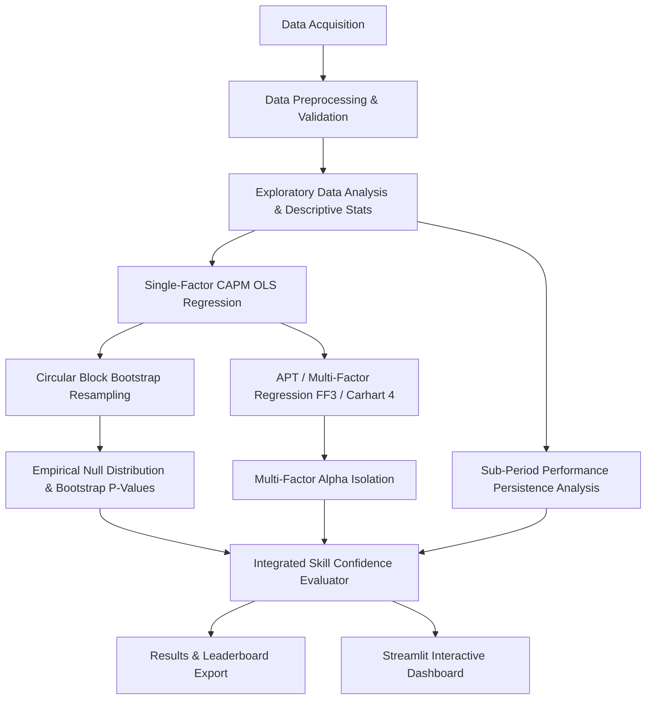

# Project Plan: Fund Manager Skill Detector

## 1. Overall Project Objective
The primary objective of the **Fund Manager Skill Detector** project is to build an end-to-end, statistically robust quantitative application to evaluate active mutual fund / portfolio manager performance. 

Standard performance metrics (such as raw return or simple Jensen's Alpha under CAPM OLS regression) are often misleading because financial returns violate independent and identically distributed (i.i.d.) normal assumptions, exhibit fat tails, display time-series dependence, and can reflect systematic factor exposures (e.g., small-cap or momentum tilts) rather than true manager stock-picking skill.

This project addresses these challenges by integrating:
1. **Single-Factor CAPM Regression**: Establishing baseline market risk-adjusted return ($\alpha, \beta$).
2. **Circular Block Bootstrap (CBB) Significance Testing**: Generating empirical non-parametric null distributions to compute bootstrap p-values and confidence intervals without relying on normal error distribution assumptions.
3. **APT / Multi-Factor Analysis**: Fitting Fama-French 3-Factor and Carhart 4-Factor models to isolate true manager alpha from factor-style risk premia ($SMB, HML, UMD$).
4. **Performance Persistence Analysis**: Evaluating manager consistency across independent sub-periods using rank correlations and transition matrices (Chi-Square independence test).
5. **Skill Confidence Score Synthesis**: Combining empirical p-values, multi-factor alpha, and persistence to assign manager skill classifications ('Skill', 'Luck', 'Unskilled', 'Inconclusive').
6. **Streamlit Interactive Dashboard**: Providing dynamic visual exploration of fund diagnostics, bootstrap distributions, factor attributions, and persistence charts.

---

## 2. End-to-End Workflow

---

## 3. Major Tasks / Phases

### Phase 1: Foundation & Project Setup (Completed)
- Establish production directory structure.
- Draft core project documentation.

### Phase 2: Data Source Verification & Acquisition Plan (Current Task)
- Verify data sources (Yahoo Finance, Fama-French Data Library / Kenneth French website).
- Document exact tickers, data frequency, units, transformations, and active management screening protocol.
- Formulate Data Acquisition Plan and Data Quality Rules.

### Phase 3: Data Acquisition & Preprocessing Pipeline
- Acquire raw datasets and save to `data/raw/`.
- Validate, clean, align, transform risk-free rates, and compute excess returns saved to `data/processed/`.

### Phase 4: Descriptive Statistics & Diagnostic Diagnostics
- Compute return distribution moments (mean, std, skewness, kurtosis, Sharpe, Sortino, max drawdown, Jarque-Bera, Ljung-Box).

### Phase 5: Single-Factor CAPM Engine
- Fit OLS linear regressions and output alpha, beta, $R^2$, and t-statistics.

### Phase 6: Circular Block Bootstrap (CBB) Engine
- Implement non-parametric block bootstrap under $H_0: \alpha \le 0$ and compute bootstrap p-values and confidence intervals.

### Phase 7: APT / Multi-Factor Analysis Engine
- Fit Fama-French 3-Factor and Carhart 4-Factor models.

### Phase 8: Performance Persistence Engine
- Sub-period splitting, Spearman rank correlation, contingency matrix, and Chi-Square independence test.

### Phase 9: Skill Confidence Evaluation Engine
- Multi-criterion classification rules into Skill, Luck, Unskilled, Inconclusive.

### Phase 10: Streamlit Dashboard & Testing
- Build interactive Streamlit dashboard and unit test suite.
